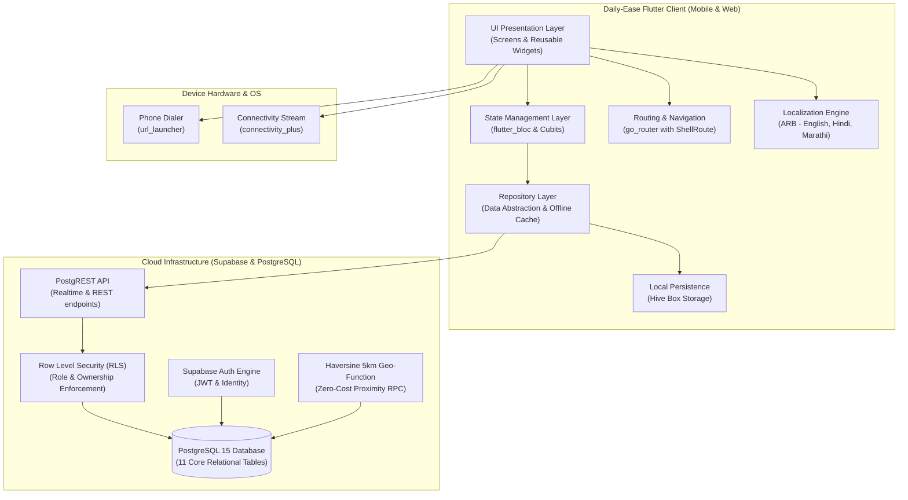
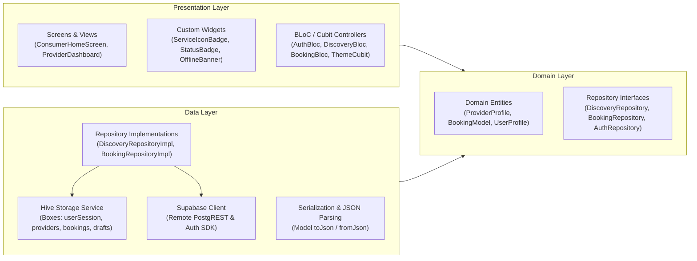
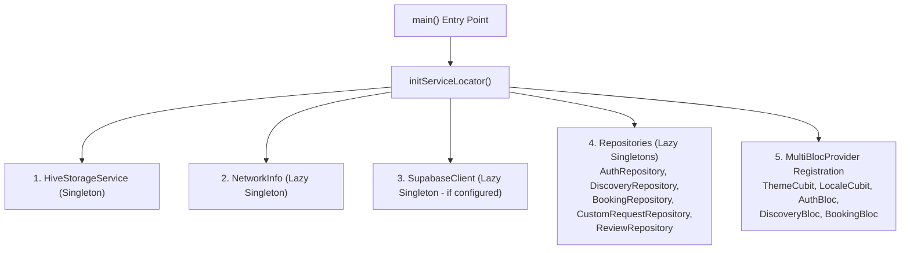
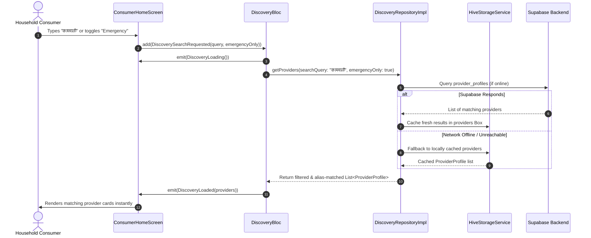
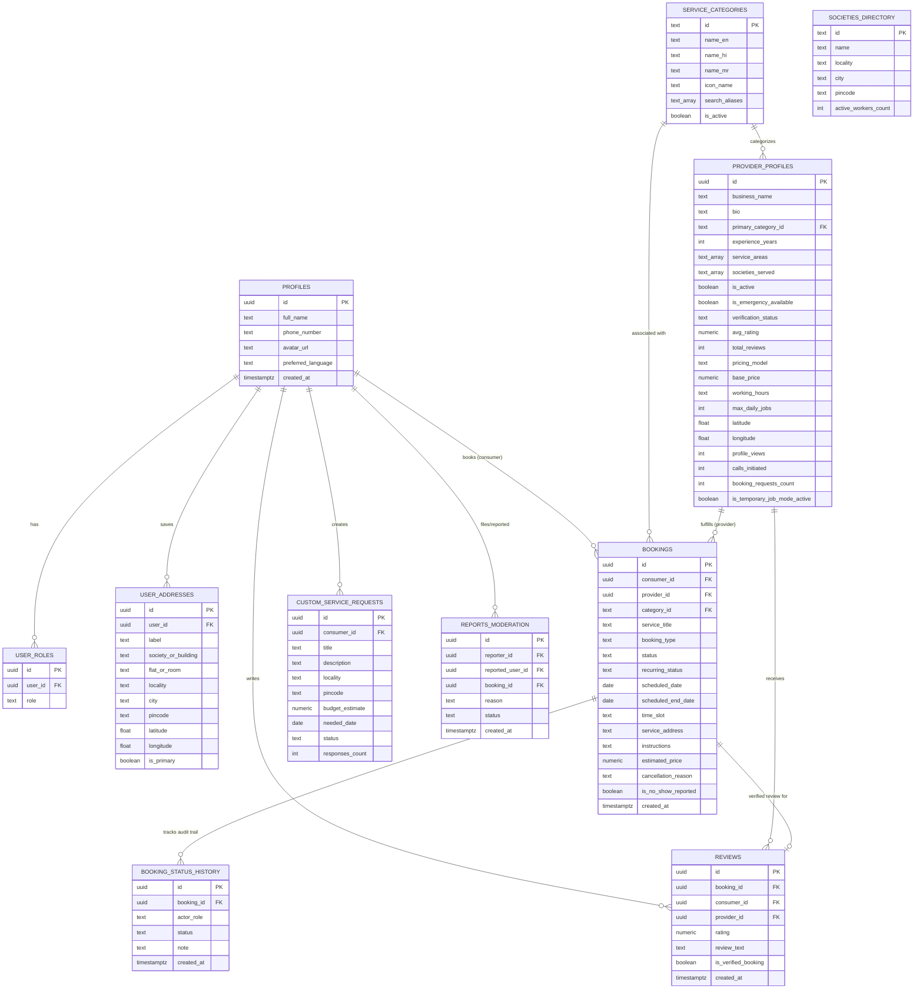
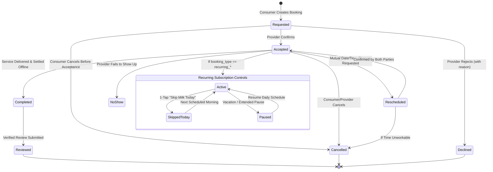
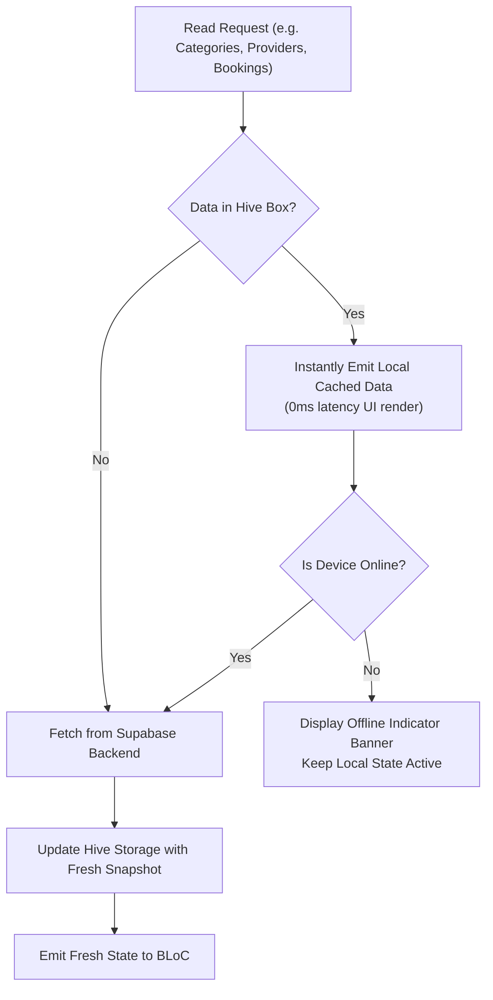

# Daily-Ease — Technical Design Document (TDD)
**Version:** 1.0.0  
**Status:** Approved / Production Ready  
**Target Platform:** Flutter (Android, iOS, Web)  
**Authors:** Daily-Ease Engineering Team  

---

## 1. Executive Summary & System Objectives

**Daily-Ease** is a hyper-local, multilingual services marketplace built to organize the fragmented domestic and neighborhood services economy. It bridges everyday households with local service providers—such as domestic helpers (maids/bai), morning milk deliverers, watchmen, plumbers, electricians, cooks, and carpenters.

### Key Problem Statements Addressed:
1. **Recurring vs. One-Time Fragility:** Traditional gig apps focus exclusively on one-time rides or deliveries. Daily-Ease treats recurring household arrangements (e.g., daily milk delivery, morning maid visits) as first-class citizens with pause, resume, and skip-day capabilities alongside 1-day urgent help.
2. **High Administrative Friction:** Workers often face weeks of manual verification on corporate portals. Daily-Ease enables instant, self-serve onboarding with transparent trust badges (`"Self-Listed"` vs. `"Verified"`).
3. **High Map API Costs:** Map APIs (e.g. Google Maps SDK / Places API) impose heavy recurring costs. Daily-Ease uses an in-database, zero-cost mathematical **Haversine formula** within PostgreSQL for sub-millisecond 5 km proximity matching without any third-party map billing.
4. **Multilingual & Cultural Usability:** Natural search alias resolution across English, Hindi, and Marathi (e.g., matching `"कामवाली"`, `"bai"`, or `"maid"`).
5. **Connectivity Resilience:** Offline-first caching using Hive ensures seamless functionality even in basements, elevators, or areas with poor cellular data.

---

## 2. High-Level System Architecture

Daily-Ease follows **Clean Architecture** organized **Feature-First**. The codebase cleanly decouples the User Interface (Presentation), Application State (BLoC / Cubit), Business Rules (Domain Entities & Use Cases), and Data Sources (Hive Local Storage and Supabase Cloud Backend).

### 2.1 System Context Diagram



---

## 3. Layered Clean Architecture Breakdown



### Layer Responsibilities:
- **Presentation Layer:** Pure Flutter UI widgets adhering to Material 3 design tokens. Consumes streams from `flutter_bloc` and dispatches user actions without referencing data transport layers directly.
- **Domain Layer:** Pure Dart business entities (`BookingModel`, `ProviderProfile`, `ServiceCategory`, `SocietyDirectoryEntry`) and abstract contracts. Free of UI and framework dependencies.
- **Data Layer:** Concrete implementations of repository interfaces. Coordinates cache-first reads from Hive, optimistic offline updates, and background sync with remote Supabase endpoints.

---

## 4. State Management & Service Locator Pattern

Daily-Ease utilizes `flutter_bloc` (v9.1.1) for complex, multi-state user flows (such as Discovery filters, Authentication, and Booking creation) and `Cubit` for lightweight, synchronous UI state (such as Dark/Light Theme and Locale selection).

### 4.1 Dependency Injection Hierarchy (`get_it`)

All core dependencies are initialized during app bootstrap in `initServiceLocator()` inside `lib/core/di/service_locator.dart`:



### 4.2 Reactive Event-State Cycle



---

## 5. Database Schema & Entity Relationship Diagram (ERD)

The database schema is organized into 11 relational tables managed under PostgreSQL 15 on Supabase with Row Level Security (RLS) enabled on every table.



---

## 6. Zero-Cost 5 km Geospatial Matching Algorithm

Rather than paying recurring costs for the Google Maps Distance Matrix or Places APIs, Daily-Ease executes a pure mathematical **Haversine formula** directly within a PostgreSQL stored function:

$$\text{distance} = 2R \cdot \arcsin\left(\sqrt{\sin^2\left(\frac{\Delta \phi}{2}\right) + \cos(\phi_1)\cos(\phi_2)\sin^2\left(\frac{\Delta \lambda}{2}\right)}\right)$$

Where $R = 6371\text{ km}$ (mean radius of Earth).

### Stored PostgreSQL Function (`get_nearby_providers_5km`):
```sql
CREATE OR REPLACE FUNCTION public.get_nearby_providers_5km(
    user_lat DOUBLE PRECISION,
    user_lng DOUBLE PRECISION,
    max_radius_km DOUBLE PRECISION DEFAULT 5.0,
    filter_category TEXT DEFAULT NULL
)
RETURNS TABLE (
    id UUID,
    business_name TEXT,
    primary_category_id TEXT,
    base_price NUMERIC,
    pricing_model TEXT,
    avg_rating NUMERIC,
    total_reviews INT,
    distance_km DOUBLE PRECISION,
    societies_served TEXT[]
) AS $$
BEGIN
    RETURN QUERY
    SELECT 
        p.id, p.business_name, p.primary_category_id, p.base_price,
        p.pricing_model, p.avg_rating, p.total_reviews,
        ROUND((6371 * acos(LEAST(1.0, GREATEST(-1.0,
            cos(radians(user_lat)) * cos(radians(p.latitude)) *
            cos(radians(p.longitude) - radians(user_lng)) +
            sin(radians(user_lat)) * sin(radians(p.latitude))
        ))))::numeric, 2)::double precision AS distance_km,
        p.societies_served
    FROM public.provider_profiles p
    WHERE p.is_active = true
      AND p.latitude IS NOT NULL AND p.longitude IS NOT NULL
      AND (filter_category IS NULL OR filter_category = 'all' OR p.primary_category_id = filter_category)
      AND (6371 * acos(LEAST(1.0, GREATEST(-1.0,
            cos(radians(user_lat)) * cos(radians(p.latitude)) *
            cos(radians(p.longitude) - radians(user_lng)) +
            sin(radians(user_lat)) * sin(radians(p.latitude))
          )))) <= max_radius_km
    ORDER BY distance_km ASC;
END;
$$ LANGUAGE plpgsql SECURITY DEFINER;
```

---

## 7. Booking Lifecycle & State Machine

The booking model supports both **single-day urgent visits** and **long-term recurring household subscriptions** (e.g. daily milk delivery, daily maid visits). Every transition updates `public.bookings` and logs an immutable audit event in `public.booking_status_history`.



---

## 8. Security, Row Level Security (RLS) & Privacy

### 8.1 Row Level Security (RLS) Enforcement
Every database table in `supabase_schema.sql` has RLS enabled with granular policies:
- **`profiles`:** Publicly queryable (for displaying worker names/avatars); writable strictly by `auth.uid() = id`.
- **`provider_profiles`:** Publicly queryable if `is_active = true`; modifications restricted to the provider's authenticated account.
- **`bookings`:** Strictly visible only to `consumer_id` and `provider_id`. Third parties cannot view or query bookings between other users.
- **`reviews`:** Only consumers with a `completed` booking can insert a review (`auth.uid() = consumer_id`).
- **`user_addresses`:** Strictly isolated to `auth.uid() = user_id`.

### 8.2 Contact Privacy & Direct Calling Policy
- Providers can opt in to allow direct phone calls from verified profiles.
- When direct calling is initiated, the app fires `url_launcher` with `tel:<phone_number>` and simultaneously logs an analytics counter (`calls_initiated`) on the provider profile.
- Phone numbers in logs are automatically masked by `AppLogger` (`+91 98*** **345`) to prevent PII exposure in development and crash reporting.

---

## 9. Multilingual Localization Architecture

Daily-Ease implements native tri-lingual support across English, Hindi (हिंदी), and Marathi (मराठी) using the Flutter standard Application Resource Bundle (`.arb`) format:
- `lib/l10n/app_en.arb`
- `lib/l10n/app_hi.arb`
- `lib/l10n/app_mr.arb`

### Multilingual Search Alias Engine
To accommodate phonetic and colloquial vernacular terms, each service category includes multilingual aliases. When a consumer queries `"doodh"`, `"कामवाली"`, or `"बाई"`, the category resolver in `ServiceCategoriesCatalog` matches against `search_aliases` with case-insensitive tokenization.

### Typography Fallbacks
To prevent missing character glyphs ("tofu") when switching between Roman and Devanagari scripts, the app theme configures Google Fonts with automatic Devanagari font fallbacks.

---

## 10. Offline-First Resilience & Caching Strategy



### Hive Boxes Configured:
1. `HiveBoxes.userSession` — Stores active user profile, auth token, and selected role.
2. `HiveBoxes.providers` — Stores provider profiles snapshot for offline search.
3. `HiveBoxes.bookings` — Stores active and past household bookings.
4. `HiveBoxes.drafts` — Preserves partially filled booking forms across app restarts.
5. `HiveBoxes.societies` — Caches residential society directory and counts.
6. `HiveBoxes.settings` — Persists dark/light theme choice and chosen language (`en`, `hi`, `mr`).

---

## 11. Technical Specifications Summary

| Layer | Technology | Version | Purpose |
| :--- | :--- | :--- | :--- |
| **Framework** | Flutter | 3.44.1+ | Cross-platform client SDK |
| **Language** | Dart | 3.12.1+ | Core programming language |
| **State Management** | flutter_bloc & equatable | 9.1.1 / 2.1.0 | Predictable, event-driven state |
| **Dependency Injection** | get_it | 8.0.3 | Service locator & repository binding |
| **Navigation** | go_router | 14.8.1 | Declarative URL-based routing with ShellRoute |
| **Persistence / Cache** | hive_flutter | 1.1.0 | Fast, lightweight, NoSQL key-value store |
| **Backend & Auth** | supabase_flutter | 2.17.2 | Authentication, PostgREST API, RLS |
| **Database** | PostgreSQL | 15.x | Relational storage & Haversine proximity |
| **Network Monitoring** | connectivity_plus | 6.1.3 | Real-time network stream detection |
| **Device Integration** | url_launcher | 6.3.1 | Native phone dialer execution |
| **Notifications** | toastification | 3.2.0 | High-fidelity interactive toast banners |
| **Typography** | google_fonts | 8.2.1 | Devanagari and Latin typography |
